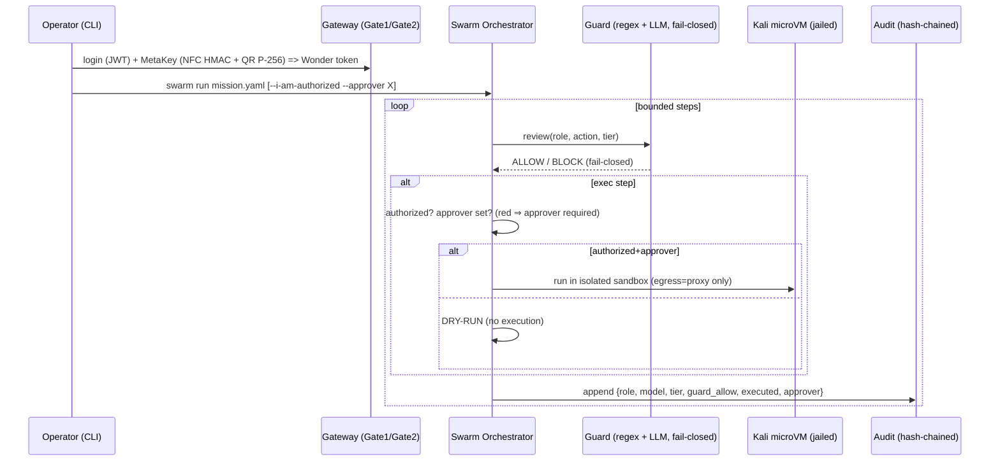
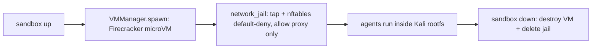

# MuseBreak CLI — Command Center & Sandboxed Agent Swarm (Design)

> **Scope & intent.** This is a *defensive* security-research platform. The Kali microVM is a **controlled,
> isolated lab sandbox** for running agents against systems you own or are explicitly authorized to test.
> It is **not** a tool for attacking third parties, and this repo ships **no exploit/attack tooling** — the
> sandbox merely hosts standard pentest utilities for authorized lab use, and the swarm orchestrates
> **planning and analysis**. Every action is wrapped by the existing 2-gate auth + guard review + hash-chained
> audit log, and red-tier actions require a **named human approver**.

## 1. Overview
The CLI (`musebreak`) is the command center over the existing MuseBreak gateway. It adds a **swarm orchestrator**
that coordinates role-based agents. **Muse Code** is the agent runtime / tool-calling layer; model calls are
routed by tier and always flow **through the gateway** (`/muse/query` → guard → Metabolic sim → upstream) or the
Go proxy — never directly to a model. The swarm runs inside, and operates on, a **Kali Firecracker microVM** with
`cage/network_jail.py` egress isolation (default-deny; only the MuseBreak proxy is reachable).

## 2. Components
| Component | Module | Role |
|---|---|---|
| Command center | `cli/musebreak_cli/main.py` (Typer) | `login`, `swarm run/status`, `agents list`, `sandbox up/down/status`, `audit tail`, `models list` |
| Swarm orchestrator | `orchestrator.py` | async, role-based, **bounded steps**; wraps every step in guard + authorization + audit |
| Model router | `model_router.py` | role → model/tier routing table; escalate-only sensitivity |
| Gateway client | `gateway_client.py` | real Gate1+Gate2 flow + `/muse/query` (mirrors the MetaKey sim) |
| Sandbox manager | `sandbox.py` | wraps `cage/vm_manager.py` + `network_jail.py`; **mock** when KVM/rootfs absent |
| Mission schema | `missions/*.yaml` | objective, scope, `authorized`, `human_approver`, `max_steps`, roles |

## 3. Agent roles (operator-console roster)
| Role | Model (label) | Open equivalent | Responsibility | VM |
|---|---|---|---|---|
| **orchestrator** | Muse Wonderful | Llama-3-70B | Decompose the mission; coordinate workers | — |
| **recon** | Llama-3-8B | Llama-3-8B | Defensive asset inventory on OWN lab only (e.g. `nmap -sV`) | kali |
| **code** | Muse Code | Code Llama | Plan/write defensive patches | kali |
| **review** | Llama-Guard-3-8B + Llama-3-70B | same | Prefilter + deep safety review (fail-closed) | — |
| **analyzer** | Muse Wonderful-Cyber (red) | Llama-3-70B | Vuln→mitigation mapping ONLY — no exploit gen | kali |
| **report** | Llama-3-70B | Llama-3-70B | Authorized lab report | — |

Open equivalents are **labels** — we do not assert a proprietary Meta Muse endpoint. Legacy aliases (`planner`→orchestrator, `exploitdev`→analyzer, …) still route.

## 4. Model routing tiers
Ladder (most → least capable): `wonderful-cyber` > `wonderful` > `wonder` > `spark` > `glimmer`/`llama` (open-weight).

| Role | Model | Tier | Why |
|---|---|---|---|
| Planner | muse-wonderful | blue | long-horizon planning / decomposition |
| Recon-Analyst | muse-wonder | blue | frontier reasoning over lab data |
| ExploitDev | muse-wonderful-cyber | **red** | defensive/lab-only analysis; red ⇒ human approver + guard |
| Reviewer | muse-spark-1.1 | green | fast safety review |
| Reporter | glimmer (open-weight) | green | cheap, local-capable write-ups |
| default/bulk | llama-3.1-8b (open-weight) | green | offline workhorse |

Routing is **escalate-only**: a sensitive step may raise a tier, never silently lower it. Tier = Metabolic
routing + policy; red additionally gates on a human approver.

## 5. How auth + guard + audit wrap every step

## 6. Kali Firecracker sandbox lifecycle

- **Isolation:** one microVM per session; `/dev/kvm` required; egress default-deny except the MuseBreak proxy.
- **Mock mode:** with no KVM/Firecracker/Kali rootfs (e.g. CI, this box), the manager returns a mock VM so the
  CLI and tests run offline. Nothing actually executes.

### Kali rootfs (placeholder — build it yourself)
This repo does **not** ship a Kali image. Build an ext4 rootfs from the official Kali bootstrap and point
`FC_ROOTFS` at it, with `FC_KERNEL` set to a Firecracker-compatible kernel:
1. Install the proxy/kernel per `cage/fetch_firecracker.sh` and the Firecracker getting-started guide.
2. `sudo debootstrap`/`kali-rootfs` → mount an ext4 image → install the pentest metapackage you need →
   add only standard, licensed tooling for **authorized lab** use.
3. `export FC_KERNEL=/path/vmlinux FC_ROOTFS=/path/kali-rootfs.ext4` and run `MUSEBREAK_MOCK=0 musebreak sandbox up`.
The sandbox manager refuses to start unless `FC_ROOTFS` names a Kali image and `/dev/kvm` exists.

## 7. Safety & authorization (enforced in code)
- **Dry-run by default.** Exec steps never run unless the mission is `authorized: true` (CLI `--i-am-authorized`)
  **and** a `human_approver` is set. Red-tier exec always requires the approver. (`Swarm._authorized_for_exec`.)
- **Guard on every step.** `backend/guard/review_engine.review` runs the regex prefilter + (when configured) an
  LLM reviewer; it is **fail-closed**. Offline/mock runs the regex stage so injection/offensive intent is still
  blocked; authorization for exec is enforced independently.
- **Full audit.** Every step appends to a hash-chained JSONL log with role, model, tier, guard verdict, whether
  it executed, and the approver — tamper-evident via `verify_chain()`.
- **Bounded autonomy.** `max_steps` caps the swarm; there is no unbounded self-directed loop.
- **No bypass.** All model calls go through the gateway's gates/guard; there is no path that skips them.
- **Defensive only.** Red tier = authorized defensive research on in-scope lab systems. The platform will not
  produce offensive/attack tooling; such requests are blocked by the guard and refused by the upstream prompt.
