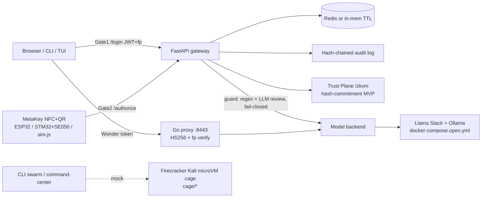

# MuseBreak — Master README (Ultimate Full-Stack Release)

MuseBreak is an open-source (MIT) **Zero-Trust gateway for AI models**: no password alone reaches the
high tier model. A request needs **Gate 1** (JWT bound to a device fingerprint) **and Gate 2** (a physical
**MetaKey**: NFC HMAC tap + P-256-signed QR intent). Around that gateway the repo ships a Go
verifying proxy, a web command center, a CLI/TUI operator console with a mock agent swarm, a
hash-commitment "Trust Plane" MVP, MetaKey hardware/firmware references, Firecracker cage scripts and
an open-weight Meta (Llama Stack) compose stack.

> "Muse Spark / Wonder / Code" are project tier names. They map to open Llama models via config;
> this repo does not hard-code any private Meta endpoint. Unconfigured model calls return `SIMULATED`.

## Architecture


## Inventory
| Area | Paths |
|---|---|
| Backend (FastAPI) | `backend/main.py` (`/health /login /challenge /authorize /keys/enroll /muse/query /audit`), `crypto.py`, `store.py`, `audit.py`, `guard/`, `metabolic_sim.py`, `open_source.py` |
| Trust Plane | `backend/zkvm/` (canonical, hash, prover, verifier, router `/zkvm/circuits /prove /verify`), 5 circuits: order_approve, audit_chain, utr_unique, vuln_chain, business_isolation; `backend/metakey/orders.py` |
| Agents | `backend/agents/` 7 agents + `orchestrator_v2.py` (scaffolds/mocked) |
| Model clients | `backend/meta_clients/` (gateway, open_weights) |
| Go proxy | `proxy/main.go` + `main_test.go` |
| Frontend (Next.js 14) | Access Control `/`, `/swarm` Claw Harness, `/verify`, plus `/audit /demo /legacy /metakeys /routing /sessions /settings` |
| CLI / TUI | `cli/musebreak_cli/` — `auth key swarm agent(s) kali sandbox code audit config zkvm models voice learn login command-center` |
| Hardware | `hardware/metakey_sim.js`, `metakey_esp32.ino`, `WIRING.md`, demo PEM keys; `firmware/metakey_auth.c` |
| Cage | `cage/vm_manager.py`, `network_jail.py`, `fetch_firecracker.sh` |
| Open stack | `docker-compose.open.yml`, `llama-stack-run.yaml`, `services/{sam,dinov2,seamlessm4t}`, `docs/OPEN_SOURCE_STACK.md` |
| Load test | `loadtest/` (Locust + mock upstream + report) |

## Real vs Simulated (honest)
| Component | Status |
|---|---|
| Gate 1 JWT + fingerprint binding, Gate 2 HMAC (constant-time) + P-256 QR, single-use challenge, counter anti-replay | **Real** (tested) |
| Hash-chained audit log + `verify_chain()` | **Real** (tested) |
| Guard regex prefilter, fail-closed | **Real**; LLM review needs your vLLM/Llama Guard |
| Go proxy token + fingerprint verification | **Real** (Go tests) |
| Trust Plane prove/verify roundtrip, 5 circuit checks | **Real hash commitment — NOT zero-knowledge**. `implementation: "hash-commitment-mvp"`, `simulated: true`. The 256-byte proof is a 32-byte digest + zero padding (encoding artifact). |
| MetaKey `/auth` FIDO binding: UTR draft → WebAuthn assertion → `fido_binding` commitment → MuV approve → verify | **Real** WebAuthn signature verification (py_webauthn) for registered credentials; UTR replay rejected. Simulated assertion fallback is labelled `simulated_assertion: true`. State in-memory. |
| MetaKey physical device (FIDO2 L2 cert, IP68, certified Secure Element, crypto wallet) | **Product concept / target** — not implemented or certified. See `docs/METAKEY_PRODUCT.md` |
| Model responses when `META_MODEL_API_URL` unset | **Simulated** (labelled) |
| Metabolic M1 latency/cost | **Simulator** |
| CLI swarm agents, TUI stage walk (Perception→Reasoning→Voice→Action) | **Mocked** (`MUSEBREAK_MOCK=1`), labelled on screen |
| Kali microVMs, CPU/MEM, boot logs (CLI, TUI, `/swarm`) | **Simulated** — needs Linux host with KVM + Firecracker; not run in CI |
| `voice`, `learn`, most backend agents | **Scaffolds** |
| Firmware / ESP32 / STM32 wiring | Reference code, not validated on hardware here |
| Open stack compose | Config provided; requires Docker + GPU/CPU capacity, not executed in this release check |
| Load test | Harness real; numbers in `loadtest/results/` are from a local run only |

## Verified at this release
- Backend `pytest`: **34 passed**
- CLI `pytest tests`: **15 passed**
- Go proxy `go test`: **2 tests passed**
- Frontend `npm run build`: **succeeds** (all routes static-prerendered)

## How to run
```bash
# Backend
cd backend && python3 -m venv .venv && . .venv/bin/activate && pip install -r requirements.txt pytest httpx
pytest -q tests && uvicorn main:app --port 8000
# MetaKey phone sim E2E
node hardware/metakey_sim.js http://localhost:8000
# Go proxy
(cd loadtest && uvicorn mock_upstream:app --port 9000 &)
cd proxy && go test ./... && UPSTREAM_URL=http://localhost:9000 go run .
# Frontend  → http://localhost:3000  (/, /swarm, /verify, /auth)
cd frontend && npm install && NEXT_PUBLIC_API_URL=http://localhost:8000 npm run dev
# CLI + TUI
pip install -e cli && export MUSEBREAK_MOCK=1
musebreak command-center         # q quit, r re-run, s spawn mock Kali VM
musebreak zkvm prove --demo
# Open Meta stack
docker compose -f docker-compose.open.yml up -d
```

## Demo path (≈5 min)
1. Login `judge` / `musebreak` on `/` → Gate 1.
2. Run `metakey_sim.js` (or the NFC/QR UI) → Gate 2 → Wonder token (60 s).
3. Replay the same tap → **401** (anti-replay).
4. `/verify` → prove + verify an order commitment (hash-commitment MVP).
5. `/swarm` Claw Harness and `musebreak command-center` → mock swarm (labelled simulated).
6. `GET /audit` → hash chain verifies.

## ⚠️ Demo keys
`hardware/demo_metakey_private.pem`, demo login and default secrets are **public demo material**.
Never use them in production; generate keys with `tools/enroll_dev_key.py` and set `JWT_SECRET`, `ENROLL_TOKEN`.

## Notes for Meta judges
- The security core (two gates, anti-replay, audit chain, proxy) is real and tested.
- The Trust Plane is deliberately labelled a hash-commitment MVP; real ZK (SP1 / RISC Zero) is future work.
- Swarm/VM telemetry is visual simulation until run on a KVM host.
- No performance or cost claims are made beyond the local load-test artifacts.

## Future work
SP1 / RISC Zero proofs; live Firecracker VM telemetry and backend grant/revoke for claws; voice/learn
implementations; hardware validation of SE050 firmware; CI (GitHub Actions); Kali rootfs build script.
