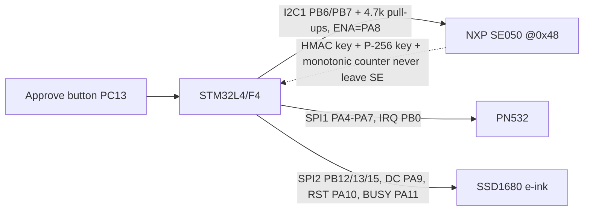

# MetaKey wiring — STM32 + NXP SE050 + PN532 + e-ink

> **REFERENCE DESIGN — NOT VALIDATED.** Pin numbers below target an STM32L432KC / STM32F411 (Nucleo/Black Pill)
> with an SE050 breakout (e.g. OM-SE050ARD) and common PN532 / 2.13" SSD1680 e-ink modules.
> Verify every pin against the datasheets of *your* exact parts (STM32 RM/DS, NXP SE050 DS AN12436,
> PN532 UM0701-02, your e-ink panel's controller DS) before powering anything. All logic is **3.3 V**.

## Power
| Rail | Source | Notes |
|---|---|---|
| 3V3 | STM32 board LDO (or ≥300 mA LDO) | SE050 VCC, PN532 VCC, e-ink VCC |
| GND | common | single star ground; keep NFC antenna return short |
| Decoupling | 100 nF + 1 µF at each IC VCC | SE050 datasheet recommends local decoupling |

## NXP SE050 — I²C (7-bit address **0x48**, T=1 over I²C)
| Signal | STM32 pin (I2C1) | SE050 breakout | Notes |
|---|---|---|---|
| SCL | PB6 | SCL | **4.7 kΩ pull-up to 3V3** |
| SDA | PB7 | SDA | **4.7 kΩ pull-up to 3V3** |
| ENA / RST_N | PA8 (GPIO out, push-pull) | ENA | drive high to enable; pulse low to reset |
| VCC | 3V3 | VCC / VIN | |
| GND | GND | GND | |
Bus speed: start at 100 kHz, raise to 400 kHz once stable (Fm+ 1 MHz only with suitable pull-ups / short traces).

## PN532 NFC — SPI (set module DIP/jumpers to SPI mode)
| Signal | STM32 pin (SPI1) | PN532 | Notes |
|---|---|---|---|
| SCK | PA5 | SCK | SPI mode 0, **LSB-first**, ≤ 5 MHz |
| MISO | PA6 | MISO | |
| MOSI | PA7 | MOSI | |
| NSS | PA4 (GPIO) | SS | software CS, active low |
| IRQ | PB0 (EXTI) | IRQ | optional, active low |
| RSTO/RSTPDN | PB1 | RST | optional |

## E-ink (SSD1680 2.13") — SPI (SPI2)
| Signal | STM32 pin | Panel | Notes |
|---|---|---|---|
| SCK | PB13 | CLK | mode 0, ≤ 10 MHz |
| MOSI | PB15 | DIN | write-only |
| CS | PB12 | CS | active low |
| DC | PA9 | DC | command/data |
| RST | PA10 | RST | active low |
| BUSY | PA11 | BUSY | input, high = busy (check your panel's polarity) |

## User presence
| Signal | STM32 | Notes |
|---|---|---|
| APPROVE button | PC13 (or any GPIO, internal pull-up) | must be pressed before the QR intent is signed |
| Status LED | PB3 | |

## Schematic (logical)
```
                 3V3 ──┬──────────┬──────────────┬───────────────┐
                       │4.7k      │4.7k          │               │
                       │          │              │               │
 ┌──────────────┐  PB6 ┴─SCL──────┼──┐   ┌──────────────┐  ┌───────────────┐
 │   STM32L4/F4 │  PB7 ───SDA─────┴──┼───│  NXP SE050   │  │  PN532 (SPI)  │
 │              │  PA8 ───ENA────────┼───│  addr 0x48   │  │               │
 │              │                    └───│ VCC GND      │  │               │
 │   SPI1  PA5 ─┼──SCK──────────────────────────────────────┤ SCK           │
 │         PA6 ─┼──MISO─────────────────────────────────────┤ MISO          │
 │         PA7 ─┼──MOSI─────────────────────────────────────┤ MOSI          │
 │         PA4 ─┼──NSS──────────────────────────────────────┤ SS   IRQ──PB0 │
 │   SPI2 PB13 ─┼──CLK──┐                                   └───────────────┘
 │        PB15 ─┼──DIN──┤  ┌────────────────────┐
 │        PB12 ─┼──CS───┼──│ SSD1680 e-ink 2.13"│
 │         PA9 ─┼──DC───┤  │ RST=PA10 BUSY=PA11 │
 │        PC13 ─┼──[APPROVE btn]──GND            └────────────────────┘
 └──────────────┘
```


## Firmware mapping
* `firmware/metakey_auth.c` — NFC response (HMAC + non-volatile monotonic counter). Host-testable with `-DHOST_SIM`.
* `hardware/metakey_esp32.ino` — alternative ESP32 + PN532 (I²C) + e-ink prototype without a secure element (demo only).
